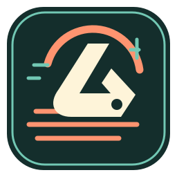

<p align="center">
  
</p>
<h1 align="center">Leonida Customs</h1>
<p align="center"><strong>Pick a vehicle, fit new parts, and see how the paint catches the light.</strong><br>An offline GTA VI vehicle viewer and customization studio for Windows.</p>
<p align="center"><a href="README.md">简体中文</a> · <a href="README.en.md">English</a></p>
<p align="center">
  <a href="https://github.com/lbyh0116/leonida-customs/releases/latest"></a>
  
  
  
</p>
<p align="center"><a href="https://github.com/lbyh0116/leonida-customs/releases/latest"><strong>↓ Download for Windows</strong></a> &nbsp; · &nbsp; <a href="https://github.com/lbyh0116/leonida-customs/issues">Report an issue</a></p>

---

## Download and run

Latest release — **v0.2.0 · Windows x64 portable**.

1. Download [Leonida-Customs-0.2.0-windows-x64.zip](https://github.com/lbyh0116/leonida-customs/releases/download/v0.2.0/Leonida-Customs-0.2.0-windows-x64.zip) and extract the entire archive to a drive with room for the preview cache.
2. Run `Start-Viewer.cmd`. The first launch downloads and verifies Godot and SixNG. Later sessions can run offline.
3. Select **Open game folder** and choose the folder in your Xbox game copy containing `levels.rpf`, `packs.rpf`, and `data.rpf`. The first scan can take a few minutes.
4. Choose a model in the vehicle library on the left. Once the preview loads, use the panel on the right to select a stock configuration, try parts, or change the paint.

Requires Windows 10 version 2004 (build 19041) or later and a Vulkan-capable GPU and driver. Tested with Xbox Series game version 1.0.2.1. The viewer reads your own assets locally. The download contains no game files.

To switch languages, open **Settings → Display language**, select English or 简体中文, and choose **Apply language**. Indexes, caches, settings, and logs are stored in the portable folder under `work`.

## Garage and studio

<table>
<tr>
<td width="50%" valign="top"><strong>Vehicle library</strong><br><br>Browse by category and search by Chinese or English name, manufacturer, or model ID. Vehicle stats come from local metadata and the in-game catalog.</td>
<td width="50%" valign="top"><strong>Parts and paint</strong><br><br>Start from a stock configuration, then preview parts and gloss, metallic, matte, or pearlescent paint. Changing parts preserves the camera. Selecting another vehicle starts a fresh stock preview.</td>
</tr>
<tr>
<td width="50%" valign="top"><strong>Build codes</strong><br><br>Copy the vehicle, stock configuration, and selected parts. Other players can import the code with their local assets. <a href="SHARE-CODE.md">Build-code format</a></td>
<td width="50%" valign="top"><strong>Studio</strong><br><br>Choose a white or black backdrop, adjust lighting, exposure, floor color and roughness, and save the viewport as a PNG. Vehicle lights are on by default.</td>
</tr>
</table>

Left-drag to orbit, right-drag to pan, scroll to zoom, and double-click to reset. In free camera mode, left-drag to look, use WASD to move, Q/E to rise or descend, Shift to move faster, the wheel to adjust speed, and Esc to exit.

| Graphics mode | Support |
| --- | --- |
| Rasterization | Godot Forward+ with TAA, FXAA, SMAA, MSAA, and FSR 2.2. Reflections, ambient occlusion, and indirect lighting are adjustable. |
| Full path tracing | Requires Godot RTX and a GPU with hardware ray-tracing pipeline support. Select 1, 2, 4, or 8 samples per pixel. |
| NVIDIA DLSS | Requires a supported NVIDIA RTX GPU and Streamline. DLSS 4.5 Transformer Model M offers DLAA, Quality, Balanced, and Performance. Ray Reconstruction is optional in path tracing. |

Select **Apply graphics** after changing quality settings. The FPS counter reports frames presented by WinUI and defaults to a 30 FPS preview cap. **Help** shows the viewport output resolution.

## Compatibility and troubleshooting

- Support for certain stock configurations, parts, textures, and game-specific materials depends on the decoder. The app can fall back to the base mesh where assembly data is missing and reports parts it cannot fit.
- Build codes cover the vehicle, configuration, and parts. Paint changes are local to the current preview. Some clear-coat highlights use different approximations in raster and path-traced modes.
- If startup fails, try `Start-Viewer-Safe-Mode.cmd` to use stable Godot with raster defaults and skip loading the last game folder. **Help** can copy diagnostics and open the logs folder.
- Some Simplified Chinese vehicle names were checked against the GTA V catalog by English model name and variant. [Los Santos Ledger vehicle database](https://www.gtacn.org/vehicles)

## Optional RTX runtime

Run from the project or portable root after signing in to GitHub CLI. Use `-RayTracing` for the path-tracing runtime alone.

```powershell
powershell -NoProfile -ExecutionPolicy Bypass -File .\Install-ViewerRuntime.ps1 -DLSS
```

`Start-Viewer-RayTracing.cmd` launches directly into path tracing on supported hardware. If the CI artifact expires, build the pinned revision and place `godot.windows.editor.x86_64.exe` in `tools/godot-rtx`. [NVIDIA build](https://github.com/NVIDIA-RTX/godot/actions/runs/41390391716) · [Pinned Godot revision](https://github.com/NVIDIA-RTX/godot/tree/49a825dc52c0f1892ff5ce5cdbbe7572c638d41a) · [Streamline 2.10.0](https://github.com/NVIDIA-RTX/Streamline/releases/tag/v2.10.0)

## Build from source

Install the .NET 10 SDK.

```powershell
powershell -NoProfile -ExecutionPolicy Bypass -File .\setup.ps1
.\Start-Viewer.cmd
```

- `Build-WinUI.ps1` — Build the Windows app.
- `Package-Viewer.ps1` — Create the portable ZIP and its checksum in `work/dist`.
- `main.tscn` — Debug the studio without the WinUI host.

```powershell
.\tools\godot-rtx\godot.windows.editor.x86_64.exe --path . --script tests/render_mode_smoke.gd -- --require-rtx --require-dlss
```

## License and dependencies

Leonida Customs is an unofficial project unaffiliated with Rockstar Games.

[GPL-3.0-only](LICENSE) · [WinUI 3 / Windows App SDK](https://learn.microsoft.com/en-us/windows/apps/windows-app-sdk/) · [Godot 4.7.2](https://godotengine.org/download/archive/4.7.2-stable/) · [SixNG 0.11.0](https://github.com/holdmysocks/SixNG/releases/tag/v0.11.0)
