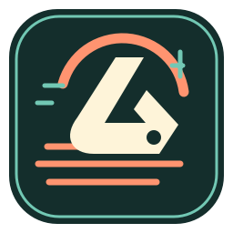

<div align="center">
  
  <h1>Leonida Customs</h1>
  <p>GTA VI 离线载具预览与改装工作室 · Windows x64</p>
</div>

Leonida Customs 用玩家自己提供的 Xbox 版资源组装并渲染载具。可按类别找车、查看图鉴性能、预览车漆与配件，以及用改车码分享配置。软件无需启动游戏，安装包和源码均不包含游戏资源。

- [下载发布版](https://github.com/lbyh0116/leonida-customs/releases) · [下载开发构建](https://github.com/lbyh0116/leonida-customs/actions/workflows/windows.yml) · [反馈问题](https://github.com/lbyh0116/leonida-customs/issues/new/choose)

## 快速开始

1. Windows 10 2004（内部版本 19041）或更高版本需要支持 Vulkan 的显卡与驱动。云母背景需要 Windows 11。
2. 完整解压 Windows x64 ZIP，再双击 `Start-Viewer.cmd`。首次启动需联网下载并校验 Godot 和 SixNG，之后可离线使用。开发构建位于 GitHub Actions 成功运行的 **Artifacts** 区域，下载需要登录 GitHub。
3. 点「打开游戏目录」，选择包含 `levels.rpf`、`packs.rpf` 和 `data.rpf` 的目录。已经验证 Xbox Series 1.0.2.1。首次扫描需数分钟，之后会复用索引。

软件以只读方式访问原始游戏资源。索引、预览缓存、设置和日志均保存在软件目录下的 `work`。可以将整个软件放在空间充足的磁盘上。也可指定启动目录，例如 `Start-Viewer.cmd "--game=G:\你的游戏目录"`。

## 在车库里做什么

| 功能 | 用法 |
| --- | --- |
| 找车 | 按简中名、英文名、厂牌或模型 ID 搜索。选车后自动显示同类别车辆。分类优先使用游戏图鉴，再按车型和档案类型补齐。 |
| 看车辆数据 | 显示档案里的驱动方式、挡位、质量，以及图鉴中的速度、加速、两项操控和强度。缺失的评分显示「—」。 |
| 预览改装 | 选原厂配置后自动列出配件。按槽位选件，再点「更新预览」。同一区域可以实时预览亮光实色、金属漆、哑光或珠光。 |
| 分享配置 | 「复制改车码」记录当前车型、配置和配件编号。接收方可用自己的本地资源导入。同版本资源更容易得到一致结果。见 [改车码说明](SHARE-CODE.md)。 |
| 导出截图 | 「保存截图」按当前视口的实际输出尺寸写入 PNG。 |

| 相机操作 | 输入 |
| --- | --- |
| 环绕 / 平移 / 缩放 | 左键拖动 / 右键拖动 / 滚轮 |
| 重置视角 | 双击视口或点「重置」 |
| 自由视角 | 启用后用鼠标环视，WASD 移动，Q/E 升降，Shift 加速，滚轮调速度，Esc 退出 |

## 摄影棚与图形设置

摄影棚的顶置柔光板位于镜头之外，可调整灯光、曝光、地面颜色和粗糙度。Godot 在后台运行，WinUI 窗口显示其渲染结果。车灯默认开启。视口右上角的 FPS 是 WinUI 每秒更新的画面数，传输上限为 30 FPS。实际输出尺寸在「帮助」中查看。图形设置会随应用保存，也可一键还原。

| 模式 | 可用选项 |
| --- | --- |
| 纯光栅（默认） | Godot Forward+。支持 TAA、FXAA、SMAA、MSAA 2×/4×/8× 和 FSR 2.2，可单独开关反射、环境光遮蔽和间接光照。 |
| 全路径追踪（可选） | 使用 NVIDIA Godot RTX，提供每像素 1、2、4 或 8 个样本。首次切换或载入新材质时可能需要等待着色器。 |
| NVIDIA DLSS（可选） | 需 Streamline 和支持的 RTX GPU。DLSS 4.5 超分与 DLAA 使用 Transformer Model M。提供 DLAA、质量、平衡和性能档位，支持时可搭配路径追踪光线重建。 |

### 安装可选 RTX 运行时

在项目或便携版根目录运行下方命令。请先安装并登录 GitHub CLI。只需要路径追踪时，将 `-DLSS` 改为 `-RayTracing`。

```powershell
powershell -NoProfile -ExecutionPolicy Bypass -File .\Install-ViewerRuntime.ps1 -DLSS
```

用 `Start-Viewer-RayTracing.cmd` 可直接进入路径追踪。安装脚本使用 [NVIDIA 官方 Windows 构建](https://github.com/NVIDIA-RTX/godot/actions/runs/41390391716) 和 [Streamline 2.10.0](https://github.com/NVIDIA-RTX/Streamline/releases/tag/v2.10.0)。构建归档到期后，可从 [对应的 NVIDIA Godot 提交](https://github.com/NVIDIA-RTX/godot/tree/49a825dc52c0f1892ff5ce5cdbbe7572c638d41a) 编译 Windows x64 编辑器，并把 `godot.windows.editor.x86_64.exe` 放进 `tools/godot-rtx`。

## 当前兼容范围

- 缺少可组装原厂配置的车型会尝试加载基础模型。可用调校件取决于资源的解码情况，找不到挂点的组件会显示装配警告。
- 车漆预览使用摄影棚的材质参数。纯光栅使用独立清漆层，全路径追踪在现有 RTX 材质模型中近似清漆高光。部分材质细节、涂装和配件受 Xbox 贴图解码和游戏专用着色器限制。
- 改车码保存车型、原厂配置和配件。目前的漆色预览只在本机生效。

## 故障排查

- 启动异常时运行 `Start-Viewer-Safe-Mode.cmd`。它会使用稳定版 Godot 和默认纯光栅设置，并跳过自动读取上次的目录。
- 停在安装窗口时，检查下载错误提示和解压目录的写入权限，然后重新运行 `Start-Viewer.cmd`。
- 反馈问题时可在「帮助」复制版本、系统、渲染能力和视口分辨率的摘要，也可打开日志所在目录。公开分享原始日志前请先去掉本地路径。

## 从源码构建

安装 .NET 10 SDK 后运行以下命令：

```powershell
powershell -NoProfile -ExecutionPolicy Bypass -File .\setup.ps1
.\Start-Viewer.cmd
```

使用 `Build-WinUI.ps1` 重新编译，使用 `Package-Viewer.ps1` 在 `work/dist` 生成便携 ZIP 和 SHA-256 文件。Godot 的 `main.tscn` 用于单独调试摄影棚。RTX 渲染切换检查无需游戏资源：

```powershell
.\tools\godot-rtx\godot.windows.editor.x86_64.exe --path . --script tests/render_mode_smoke.gd -- --require-rtx --require-dlss
```

## 许可与依赖

Leonida Customs 是非官方项目，与 Rockstar Games 无关联。项目源码按 [GPL-3.0-only](LICENSE) 发布。游戏资源由玩家自行提供。

- [Windows App SDK / WinUI 3](https://learn.microsoft.com/en-us/windows/apps/windows-app-sdk/) 2.6.5 负责 Windows 界面。
- [Godot 4.7.2](https://godotengine.org/download/archive/4.7.2-stable/) 负责同窗摄影棚渲染，采用 MIT 许可。NVIDIA 运行时按其许可单独获取。
- [SixNG 0.11.0](https://github.com/holdmysocks/SixNG/releases/tag/v0.11.0) 以独立进程读取本地资源，采用 GPL-3.0。可用 `SIXNG_EXE` 指定兼容的本地版本。
