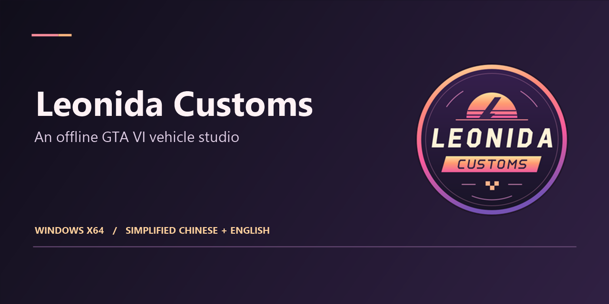

<div align="center">



**GTA VI 离线载具预览与改装工作室**

**Offline vehicle preview and customization for GTA VI**

[简体中文](#简体中文) · [English](#english)

[下载 Windows x64 / Download](https://github.com/lbyh0116/leonida-customs/releases/latest) · [开发构建 / CI builds](https://github.com/lbyh0116/leonida-customs/actions/workflows/windows.yml) · [问题反馈 / Issues](https://github.com/lbyh0116/leonida-customs/issues) · [GPL-3.0-only](LICENSE)

</div>

---

## 简体中文

Leonida Customs 用你提供的 Xbox 版游戏资源，在独立摄影棚里预览载具、试装配件和调整车漆。软件只读访问本地资源，无需启动游戏。源码与安装包均不含游戏资源。

### 快速开始

1. 确认系统为 Windows 10 2004（19041）或更高版本，显卡与驱动支持 Vulkan。云母背景需要 Windows 11。
2. 下载 Windows x64 ZIP、完整解压，然后运行 `Start-Viewer.cmd`。首次运行联网下载并校验 Godot 与 SixNG，后续可离线运行。
3. 点「打开游戏目录」，或在「设置 → 游戏文件位置」校验包含 `levels.rpf`、`packs.rpf` 和 `data.rpf` 的目录。已验证 Xbox Series 1.0.2.1。首次扫描可能需要几分钟，之后复用索引。
4. 在「设置 → 界面语言」选择简体中文或 English，然后点击「应用语言」。

索引、预览缓存、设置与日志放在软件目录下的 `work`。可以把整个软件目录放在空间充足的磁盘上，也可以通过 `Start-Viewer.cmd "--game=G:\你的游戏目录"` 指定资源位置。

### 车库与摄影棚

| 功能 | 用法 |
| --- | --- |
| 载具库 | 按类别浏览，支持用中英文车名、品牌和模型 ID 搜索。载具数据来自本地档案与游戏图鉴。 |
| 配件和车漆 | 选择原厂配置，然后在配件列表试装零件或预览实色亮光、金属漆、哑光与珠光。换件会保留当前视角，切换车型会重新从原厂配置开始。 |
| 改车码 | 复制车型、原厂配置与配件选择。其他玩家可用自己的资源导入。[改车码格式](SHARE-CODE.md) |
| 摄影棚 | 提供黑白背景预设，支持调光、曝光、地面颜色和粗糙度。车灯默认开启，可把当前视口保存为 PNG。 |

左键拖动环绕，右键拖动平移，滚轮缩放，双击视口重置。自由视角中，左键拖动环视，WASD 移动，Q/E 升降，Shift 加速，滚轮调速度，Esc 退出。

| 图形模式 | 支持情况 |
| --- | --- |
| 纯光栅 | Godot Forward+，支持 TAA、FXAA、SMAA、MSAA 和 FSR 2.2，以及反射、环境光遮蔽和间接光照选项。 |
| 全路径追踪 | 需安装 Godot RTX，且当前渲染显卡支持硬件光追管线。可选每像素 1、2、4 或 8 个样本。 |
| NVIDIA DLSS | 需支持的 NVIDIA RTX 显卡与 Streamline。提供 DLSS 4.5 Transformer Model M、DLAA、质量、平衡和性能档。路径追踪可选光线重建。 |

修改画质后点击「应用画质」。视口 FPS 显示 WinUI 实际更新画面的频率，默认上限为 30 FPS。「帮助」中可查看视口输出尺寸。

### 兼容性与排查

- 部分原厂配置、配件、贴图和游戏专用材质仍受解码支持限制。载具缺少可组装配置时会尝试载入基础模型，无法装上的组件会显示警告。
- 改车码目前记录车型、配置和配件。车漆预览留在本次本地预览。不同图形模式下，部分漆面的清漆高光采用不同近似方式。
- 启动遇到问题时，运行 `Start-Viewer-Safe-Mode.cmd` 使用稳定版 Godot 和纯光栅，并跳过自动读档。「帮助」可以复制诊断信息和打开日志目录。
- 部分跨代车型名称参考洛圣都档案，并按英文车型与版本核对。[GTA V 载具数据库](https://www.gtacn.org/vehicles)

## English

Leonida Customs is a Windows garage for previewing vehicles, trying parts, and comparing paint finishes using your own Xbox game assets. It reads your files locally in a standalone studio while the game is closed. The source and downloads ship without game assets.

### Quick start

1. Use Windows 10 2004 (build 19041) or later with a Vulkan-capable GPU and driver. The optional Mica backdrop requires Windows 11.
2. Download and fully extract the Windows x64 ZIP, then run `Start-Viewer.cmd`. The first launch downloads and verifies Godot and SixNG. Subsequent launches can run offline.
3. Choose **Open game folder**, or validate the folder under **Settings → Game folder**. It must contain `levels.rpf`, `packs.rpf`, and `data.rpf`. Xbox Series 1.0.2.1 has been tested. The first scan may take a few minutes and later launches reuse the index.
4. Choose **English** or **简体中文** in **Settings → Display language**, then select **Apply language**.

Indexes, cached previews, settings, and logs live in the portable app's `work` directory. Move the full folder to a drive with enough space, or pass a folder with `Start-Viewer.cmd "--game=G:\Your Game Folder"`.

### Garage and studio

| Feature | What you can do |
| --- | --- |
| Vehicle library | Browse by category and search by Chinese or English name, manufacturer, or model ID. Vehicle stats come from local metadata and the in-game catalog. |
| Parts and paint | Start from a stock configuration, then preview parts and gloss, metallic, matte, or pearlescent paint. Changing parts preserves the camera. Selecting another vehicle starts a fresh stock preview. |
| Build codes | Copy the vehicle, stock configuration, and selected parts. Other players can import the code with their local assets. [Build-code format](SHARE-CODE.md) |
| Studio | Choose a white or black backdrop, adjust lighting, exposure, floor color and roughness, and save the viewport as a PNG. Vehicle lights are on by default. |

Left-drag to orbit, right-drag to pan, scroll to zoom, and double-click to reset. In free camera mode, left-drag to look, use WASD to move, Q/E to rise or descend, Shift to move faster, the wheel to adjust speed, and Esc to exit.

| Graphics mode | Support |
| --- | --- |
| Rasterization | Godot Forward+ with TAA, FXAA, SMAA, MSAA, and FSR 2.2. Reflections, ambient occlusion, and indirect lighting are adjustable. |
| Full path tracing | Requires Godot RTX and a GPU with hardware ray-tracing pipeline support. Select 1, 2, 4, or 8 samples per pixel. |
| NVIDIA DLSS | Requires a supported NVIDIA RTX GPU and Streamline. DLSS 4.5 Transformer Model M offers DLAA, Quality, Balanced, and Performance. Ray Reconstruction is optional in path tracing. |

Select **Apply graphics** after changing quality settings. The FPS counter reports frames presented by WinUI and defaults to a 30 FPS preview cap. **Help** shows the viewport output resolution.

### Compatibility and troubleshooting

- Support for certain stock configurations, parts, textures, and game-specific materials depends on the decoder. The app can fall back to the base mesh where assembly data is missing and reports parts it cannot fit.
- Build codes cover the vehicle, configuration, and parts. Paint changes are local to the current preview. Some clear-coat highlights use different approximations in raster and path-traced modes.
- If startup fails, try `Start-Viewer-Safe-Mode.cmd` to use stable Godot with raster defaults and skip loading the last game folder. **Help** can copy diagnostics and open the logs folder.
- Some Simplified Chinese vehicle names were checked against the GTA V catalog by English model name and variant. [Los Santos Ledger vehicle database](https://www.gtacn.org/vehicles)

## 安装 RTX 运行时 / Optional RTX runtime

从项目或便携版根目录运行。提前安装并登录 GitHub CLI。只装路径追踪时，使用 `-RayTracing`。

Run from the project or portable root after signing in to GitHub CLI. Use `-RayTracing` for the path-tracing runtime alone.

```powershell
powershell -NoProfile -ExecutionPolicy Bypass -File .\Install-ViewerRuntime.ps1 -DLSS
```

`Start-Viewer-RayTracing.cmd` launches directly into path tracing on supported hardware. If the CI artifact expires, build the pinned revision and place `godot.windows.editor.x86_64.exe` in `tools/godot-rtx`. [NVIDIA build](https://github.com/NVIDIA-RTX/godot/actions/runs/41390391716) · [Pinned Godot revision](https://github.com/NVIDIA-RTX/godot/tree/49a825dc52c0f1892ff5ce5cdbbe7572c638d41a) · [Streamline 2.10.0](https://github.com/NVIDIA-RTX/Streamline/releases/tag/v2.10.0)

## 从源码构建 / Build from source

安装 .NET 10 SDK / Install the .NET 10 SDK.

```powershell
powershell -NoProfile -ExecutionPolicy Bypass -File .\setup.ps1
.\Start-Viewer.cmd
```

- `Build-WinUI.ps1` — 编译 WinUI / Build the Windows app.
- `Package-Viewer.ps1` — 生成便携 ZIP 与 SHA-256 至 `work/dist` / Create the portable ZIP and its checksum in `work/dist`.
- `main.tscn` — 单独调试摄影棚 / Debug the studio without the WinUI host.

```powershell
.\tools\godot-rtx\godot.windows.editor.x86_64.exe --path . --script tests/render_mode_smoke.gd -- --require-rtx --require-dlss
```

## 许可与依赖 / License and dependencies

Leonida Customs 是独立项目，与 Rockstar Games 无关联。

Leonida Customs is an unofficial project unaffiliated with Rockstar Games.

[GPL-3.0-only](LICENSE) · [WinUI 3 / Windows App SDK](https://learn.microsoft.com/en-us/windows/apps/windows-app-sdk/) · [Godot 4.7.2](https://godotengine.org/download/archive/4.7.2-stable/) · [SixNG 0.11.0](https://github.com/holdmysocks/SixNG/releases/tag/v0.11.0)
